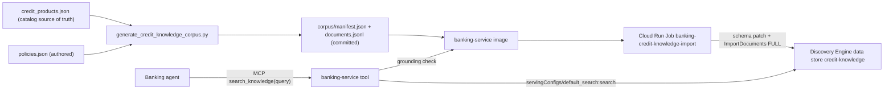

# FSI Architecture Design: Curated Credit Knowledge Store

This document defines the curated, grounded knowledge search behind the banking-service `search_knowledge` MCP tool. Banking agents use it to answer general credit card support questions, such as "how do I apply?", "what's the late fee on Everyday Cash?" or "what's the max limit on Platinum Travel?".

It sits beside the crawled site search ([Enterprise Search & Generative Answers](./enterprise_search_and_answers.md)) and doesn't replace it. The `banking-site_*` data store, the `nova_horizon_site` engine and the crawl pipeline are unchanged.

---

## 1. Components



| Piece | Location |
| :--- | :--- |
| Corpus builder (pure) | `banking-service/services/credit_knowledge_corpus.py` |
| Authored policy sections | `banking-service/resources/knowledge/credit/policies.json` |
| Generated snapshot | `banking-service/resources/knowledge/credit/corpus/` |
| Generator CLI (`--check` in CI) | `banking-service/scripts/generate_credit_knowledge_corpus.py` |
| Search port and adapters | `banking-service/services/credit_knowledge_search.py` |
| MCP tool | `banking-service/routers/mcp/knowledge.py` |
| Import job script | `banking-service/scripts/import_credit_knowledge.py` |
| Terraform | `deployment/terraform/credit_knowledge.tf`, plus env vars in `cloud_run_v2.tf` |

## 2. Corpus

- **Product documents** (`CARD-<product_code>`): one per active catalog product. They're rendered only through `present_credit_product`, so every figure is a presentation `display_text`, for example `USD 40.00` or `22.49%`. Each document has these sections:
  - `overview`
  - `purchase-apr`
  - `balance-transfers`
  - `cash-advances`
  - `fees`
  - `penalty-apr`
  - `rewards`
  - `credit-limits`
  - `feature-N`
- **Policy documents** (`POLICY-*`): short, hand-authored how-to and policy sections. They cover:
  - applying
  - payments
  - credit limit increases
  - secured card graduation
  - lost or stolen cards and fraud
  - disputes
  - fees overview
  - contacting support

  They never state per-product APRs, fees or limits; they refer to the product terms instead. A test rejects `%` and currency amounts in policy text.
- **Records.** One record per section, id `<doc_id>-<section_id>`. `structData` holds:
  - `doc_id`
  - `section_id`
  - `short_title`
  - `title`
  - `heading`
  - `text_span`
  - `kind`
  - `product_code` (products only)
  - `snapshot_id`
  - `citation`
- **Section budget.** A section's `text_span` is at most 200 characters. The builder raises, naming the doc and section, rather than truncating. A snippet is therefore always a whole stored section.
- **Snapshot.** `snapshot_id = 1-<sha256[:12]>` over the records' content. The rendered files are byte-for-byte deterministic.
- **Freshness.** `tests/test_credit_knowledge_corpus.py` and the `lint-banking-service` workflow (`generate_credit_knowledge_corpus.py --check`) fail when the catalog or policies change without a regeneration.

## 3. Invariants

1. **Grounded or unavailable.** Every returned snippet's `document.id` and its `doc_id`, `section_id`, `short_title`, `snapshot_id` and `text_span` must exactly equal a stored section of the snapshot shipped in the running image.
   - Missing fields, an unknown id, another snapshot, or drifted text make the whole search `DEPENDENCY_UNAVAILABLE` (stale or foreign index).
   - Nothing is filled in from the local corpus.
2. **Fail closed.** If `CREDIT_KNOWLEDGE_DATA_STORE_ID` or the project is unset, or the shipped corpus can't load, the tool returns `DEPENDENCY_UNAVAILABLE`. It never returns an empty "no results".
   - Transport, auth, timeout and malformed-response failures are also `DEPENDENCY_UNAVAILABLE`.
   - There's no in-memory fallback in production. `InMemoryKnowledgeSearch` is for tests and offline evaluation only.
3. **Limits.**
   - Page size is clamped to 5; the tool asks for 3.
   - Search timeout is 10 s, and only the first result page is read.
   - Results are cached for 30 minutes, keyed by (query, size, snapshot) and bounded to 256 entries. Failures aren't cached.
4. **No customer data.** The tool reads no customer or account data. It still requires the same caller authentication as every banking MCP tool (`requires_user_assertion`: OIDC caller off-local, plus a CES session capability, support target or Firebase assertion).
5. **Log safety.** Query text is logged only as `stable_log_reference(query, "knowledge_query")` plus its length. The log also records `cite_key`s, `cache_hit` and `snapshot_id`.

## 4. Tool contract

Input: `{"query": string}`, 1–500 characters after strip.

```json
{"success": true, "snapshot_id": "1-<sha12>",
 "snippets": [{"cite_key": "CARD-CASHBACK_EVERYDAY-fees", "doc_id": "CARD-CASHBACK_EVERYDAY",
               "section_id": "fees", "citation": "Nova Horizon Everyday Cash §fees (snapshot 1-<sha12>)",
               "text_span": "Annual fee: USD 0.00. Foreign transaction fee: 3%. Late fee: up to USD 40.00. Returned payment fee: up to USD 40.00."}]}
```

Errors:
- `{"success": false, "error": "INVALID_QUERY", ...}`
- `{"success": false, "error": "DEPENDENCY_UNAVAILABLE", ...}`

## 5. Data store and IAM

- **Data store.** `credit-knowledge` is global, `GENERIC`, `NO_CONTENT` and `SOLUTION_TYPE_SEARCH`. It's queried through its own `servingConfigs/default_search`, with no engine, and it isn't attached to `nova_horizon_site`.
- **Schema.** The import job applies it to `default_schema` and skips the update when it already matches:
  - every field `retrievable`;
  - `title`, `short_title`, `heading` and `text_span` `searchable`;
  - ids `indexable`.
- **Runtime.** The banking-service SA gets custom role `custom.discoveryengine.knowledgeSearcher`, which has only `discoveryengine.servingConfigs.search`.
- **Import.** `credit-knowledge-import-sa` gets custom role `custom.discoveryengine.knowledgeImporter`: `documents.import`, `operations.get`, `schemas.get` and `schemas.update`. It's the only identity that can write.

> [!NOTE]
> Discovery Engine IAM is project-scoped, so both custom roles apply to every data store in the project. The banking-service SA also keeps its pre-existing project-level `roles/discoveryengine.viewer` (used by site search), so its **effective** grant is wider than the searcher role. The narrow role records intent and stays correct if that viewer binding is later removed.

## 6. Deploy coupling and runbook

`cloudbuild-publish-deploy.yaml` runs `import-credit-knowledge` after migrations and before `deploy-service`, under `set -euo pipefail`. It points the import job at this build's image, then executes it with `--wait`.
- A failed import fails the build, so the new revision isn't deployed.
- The step is skipped only when the job doesn't exist yet.

1. **Provision (owner).** `terraform apply` creates the data store, roles, SA, job and env vars.
2. **First import.** Run `gcloud run jobs execute banking-credit-knowledge-import --region us-central1 --wait`, or let the next banking-service deploy run it.
3. **Verify.**
   - The job logs show `Applied credit knowledge schema fields=...` (or `already current`) and `Imported credit knowledge snapshot snapshot_id=<manifest snapshot_id> records=<record_count>`.
   - A `search_knowledge` call returns `success: true` with that `snapshot_id`.
   - The banking-service logs show `search_knowledge served ... cite_keys=...`.
4. **Swap window.** Between the import and the new revision taking traffic, old revisions see records from a snapshot they don't ship. They return `DEPENDENCY_UNAVAILABLE`, which agents should treat as "can't look that up right now". Indexing lag right after an import can also briefly return old documents (also unavailable) or no matches.

## 7. Follow-ups

- **Agent wiring (PR5).** Add `search_knowledge` to the credit support agent's tool allowlist and instructions.
- **Blended site search.** Optionally attach `credit-knowledge` to the `nova_horizon_site` engine so header search and answers can also cite curated sections.
- **Zero-downtime swaps.** Use snapshot-prefixed ids with INCREMENTAL import, a `snapshot_id` filter and pruning, instead of FULL reconciliation.
- **Narrow the effective grant.** Revisit the banking SA's project-level `roles/discoveryengine.viewer` once site search's needs are confirmed.
- **Grow the corpus.** Once the snapshot exceeds 100 records (the inline import limit), switch the import to a GCS source.
